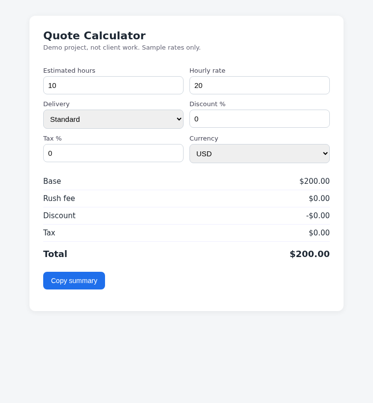

# quote-calculator

Single-file HTML/CSS/JS quote calculator. Enter hours, rate, rush surcharge, discount, tax and currency; totals update as you type, and "Copy summary" puts a one-line quote on the clipboard.

## Usage

Open `index.html` in a browser. No build step, no dependencies.

Tests for the calculation logic (Node):

    node test.js

## Behaviour

- Negative or invalid inputs count as 0.
- Discount is capped at 100% and applied before tax.
- The copy button needs a browser that allows clipboard access.
- The rates in the page are placeholder values.

